<div align="center">

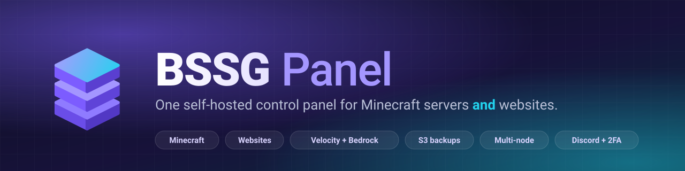

<br>

[](https://github.com/St3v3-B/BSSG-Panel/actions/workflows/check.yml)
[](LICENSE)


**Run Minecraft servers and websites from one panel, on your own hardware.**<br>
Templates, live console, files and SFTP, automatic HTTPS, S3 backups, multi-node. Discord login with 2FA.

[Quick start](#quick-start) ·
[Screenshots](#screenshots) ·
[Features](#feature-tour) ·
[Documentation](#documentation) ·
[Compare](#how-it-compares) ·
[Roadmap](#roadmap) ·
[Contributing](#contributing)

</div>

---

## Why

Running a few Minecraft servers *and* a few websites for friends or a small community usually means two panels,
two logins, two update cycles and two sets of quirks. BSSG Panel replaces both:

- **One model for everything.** A game server and a website are both a container from a template, so console,
  files, SFTP, limits, backups and permissions work the same for both.
- **Built for trusted communities.** No billing and no public sign-up. Real isolation anyway, so one compromised
  WordPress plugin cannot reach anything else.
- **Light to run.** One install script, one env file, one Go daemon per machine. Add a second machine with a single command.
- **Pleasant to use.** Modern sidebar UI, light and dark themes, English and Dutch, works well on a phone.

## Screenshots

<div align="center">
  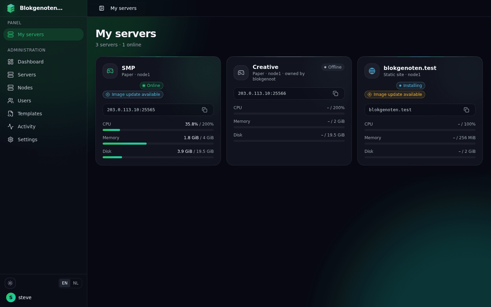
  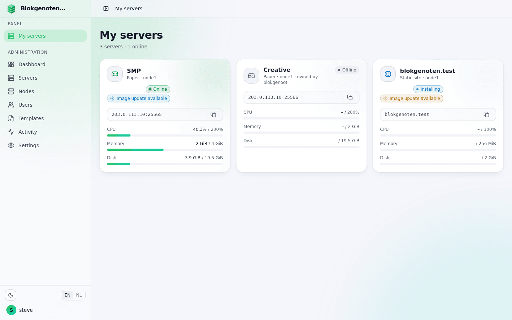
  <br>
  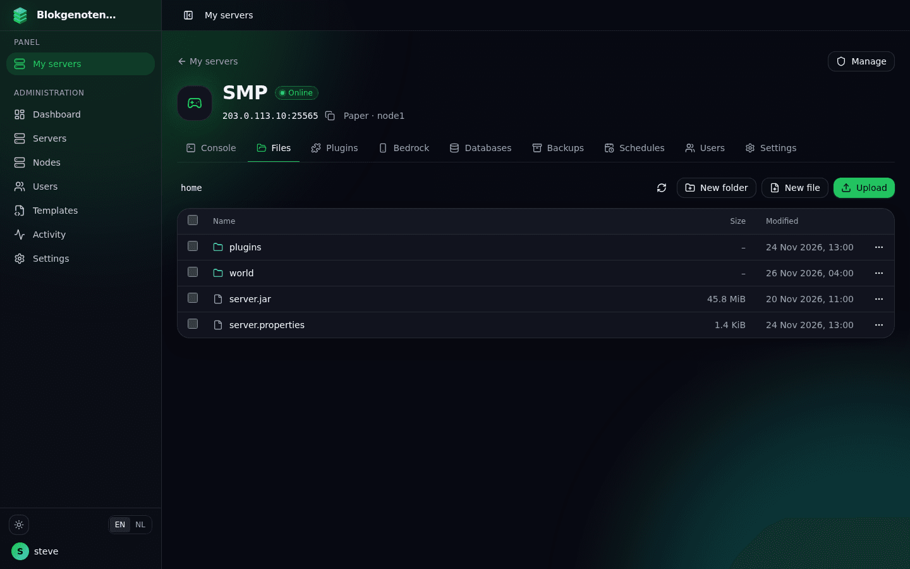
  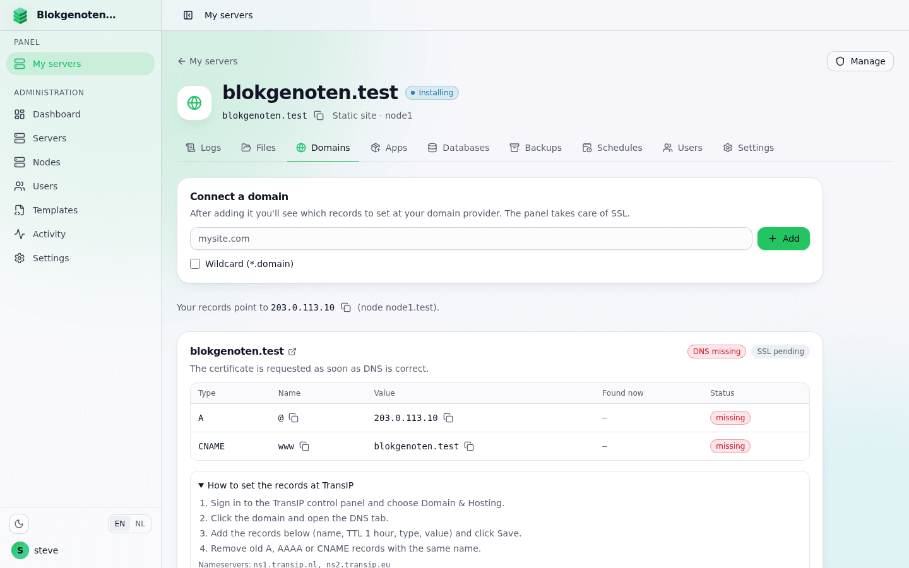
  <br>
  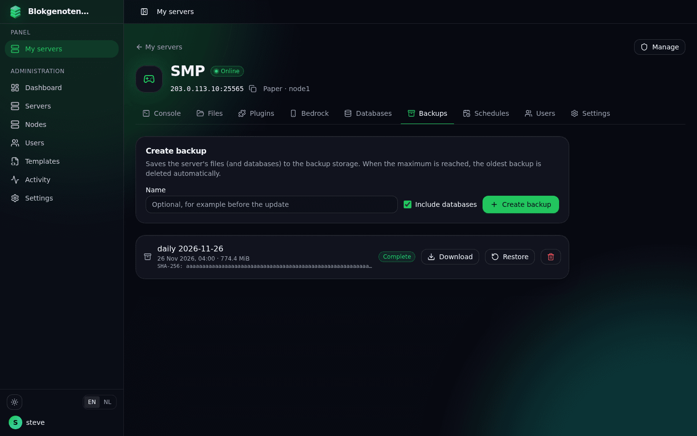
  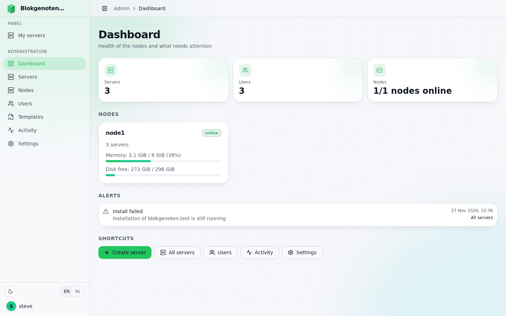
</div>

<div align="center">
  <br>
  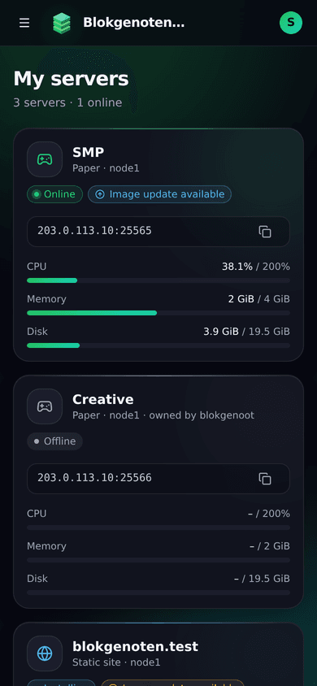
  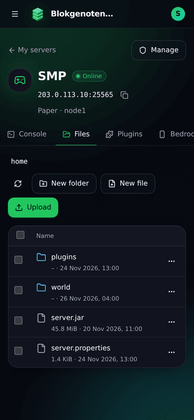
  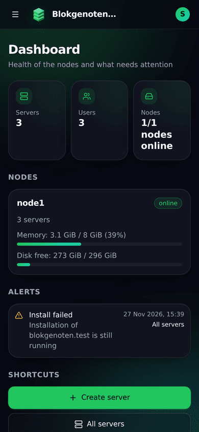
  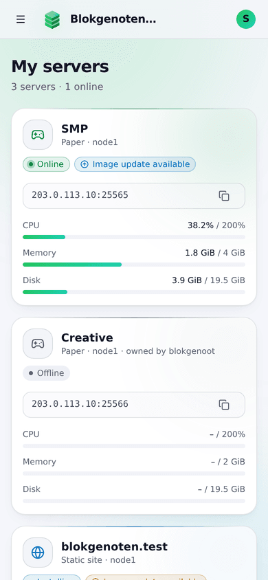
  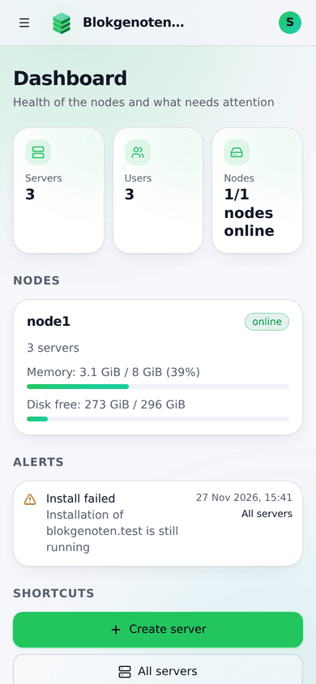
</div>

<sub>Screenshots are taken against the built-in mock with sample data. The name, logo and accent colour are configurable.</sub>

## Feature tour

### Minecraft

- **Templates** for Paper, Folia, Fabric, Velocity and any Java JAR (Java 8 to 25), with checksum-verified downloads and a version picker.
- **Live console** over a websocket straight to the node: 500-line backlog, command history, auto-reconnect.
- **Sleep mode.** Empty servers stop on their own and wake up when a player connects.
- **Plugins, mods and modpacks** from Modrinth and Hangar, with update detection.
- **Crash detection** with exit code, out-of-memory and crash-report capture, and automatic restart with backoff.
- **Domains for game servers** with SRV records, so players do not type a port.

### Networks and Bedrock

- **Velocity networks in a few clicks.** Pick backends and the panel writes `velocity.toml`, the forwarding secret and the backend settings.
- **Bedrock support** through Geyser and Floodgate, including the key distribution on a Velocity network.

### Websites

- **Static, PHP 8.2 / 8.3 / 8.4, Node.js and Adminer** templates. Each site is a non-root, read-only container on its own network.
- **Domains and SSL.** The panel shows the exact DNS records, checks them live and issues Let's Encrypt certificates through Caddy, including wildcards via Cloudflare.
- **One-click apps**: WordPress, Grav and Nextcloud, with database, config and admin login created for you.
- **PHP settings** (memory, upload size, timeouts, extensions), **cron** schedules and a log viewer.
- **MariaDB databases**, one user per database with rights on that database only.

### Operations

- **Backups to any S3-compatible storage**, with database dumps and checksums, **schedules** and one-click restore.
- **Quotas** per user (RAM, disk, CPU, servers, databases, allowed templates and nodes) so friends can create their own servers safely.
- **Automatic image updates** with a policy per server and a maintenance window.
- **Discord webhooks and bot** for crashes, failed backups, full disks and offline nodes, plus `/start`, `/stop` and `/restart` commands.
- **File manager** with a Monaco editor, drag and drop upload and zip support, plus built-in **SFTP**.
- **Activity log** of every action.

### Multi-node

- **Join a machine with one command** (`install.sh --node-only`). Each node brings its own daemon, Caddy and MariaDB.
- **Per-node domains** and a background monitor that notices when a node goes offline.
- **Move servers between nodes**, including their databases.

### Security

- Discord login, mandatory TOTP for admins, API keys, and per-server permissions for subusers.
- Hardened containers: non-root, no capabilities, read-only root filesystem, resource limits, one network per site.
- Short-lived Ed25519 browser tokens, `openat2` path confinement for files, AES-256-GCM for secrets at rest, rate limiting.
- An emergency account (password and authenticator code) for when Discord is down.

More detail: [Security model](#security-model).

## Architecture

The panel stores everything in PostgreSQL. On each node a small Go daemon does the work in Docker. Caddy is the only HTTP(S) entry point.

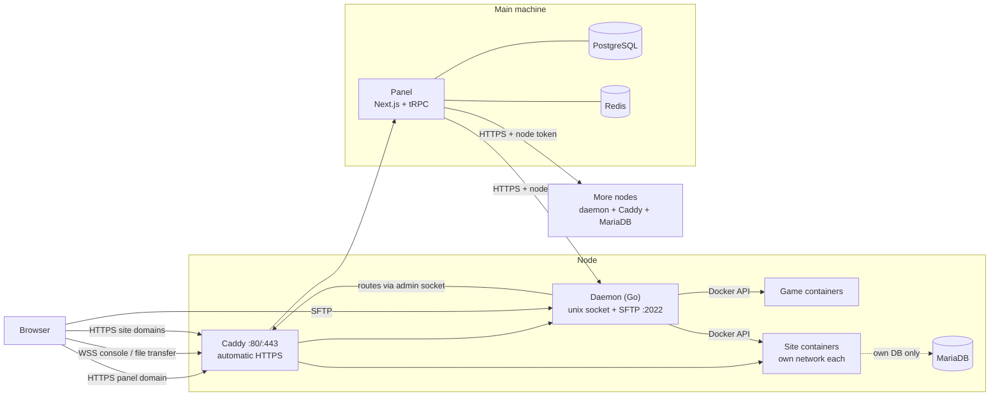

**Design decisions**

- **The daemon is never exposed directly.** It listens on a unix socket that Caddy proxies on the node's own subdomain. Only SFTP talks to it directly.
- **The daemon owns the routes.** It re-applies all Caddy routes on startup, after a Caddy restart and every five minutes.
- **Caddy's admin API is a unix socket**, so no container can reconfigure it.
- **Everything the daemon creates is labelled** `panel.managed=true` and `panel.instance=...`. It never touches other containers on the machine.
- **Contracts first.** The tRPC contract, daemon OpenAPI, template schema and Caddy interface were written before the implementation.

## Quick start

> [!IMPORTANT]
> The installer targets a **dedicated Linux machine** (tested on Ubuntu 24.04) with Docker and systemd. Ports **80, 443 and 2022** must be free.

**You need:** Docker with the Compose plugin, Go 1.23+ (or a prebuilt daemon via `--daemon-bin`), two DNS A records
(for example `panel.example.com` and `node1.example.com`), and a Discord application with the redirect URI
`https://panel.example.com/api/auth/discord/callback`.

```bash
git clone https://github.com/St3v3-B/BSSG-Panel.git
cd BSSG-Panel
sudo deploy/install.sh
```

The installer asks for your domains, your Discord user ID and the Discord client ID and secret, writes `/etc/panel/panel.env`, builds the daemon and starts the stack.
Running it again is safe. Then open the panel, sign in with Discord, enable 2FA in **Account** and head to **Admin** to add ports and create your first server.

Non-interactive and dry-run modes, prebuilt daemon binary and everything else: [docs/installation.md](docs/installation.md).

### Add another machine

In **Admin, Nodes** create a node. The panel prints a one-time command like this, which you run as root on the new machine:

```bash
git clone --depth 1 https://github.com/St3v3-B/BSSG-Panel.git /opt/panel-node
PANEL_URL='https://panel.example.com' NODE_DOMAIN='node2.example.com' NODE_TOKEN='<token>' \
ACME_EMAIL='you@example.com' /opt/panel-node/deploy/install.sh --node-only --non-interactive
```

See [docs/multi-node.md](docs/multi-node.md).

### Update

```bash
cd BSSG-Panel && git pull && sudo deploy/install.sh --non-interactive
```

## Configuration

All install-specific settings live in one file, `/etc/panel/panel.env`, read by Docker Compose and by the daemon. No domain is hardcoded in the code or database.
The commented reference is [`deploy/panel.env.example`](deploy/panel.env.example); the main variables are explained in
[docs/installation.md](docs/installation.md#configuration).

## Documentation

| Guide | For |
|---|---|
| [Installation](docs/installation.md) | Install, configure, update |
| [User guide](docs/user-guide.md) | Using servers, files, SFTP, subusers, notifications |
| [Admin guide](docs/admin-guide.md) | Users, quotas, nodes, templates, settings |
| [Multi-node](docs/multi-node.md) | Join machines, transfer servers |
| [Backups](docs/backups.md) | S3 targets, restores, schedules |
| [Minecraft](docs/minecraft.md) | Sleep mode, Velocity, Bedrock, plugins and modpacks |
| [Websites](docs/websites.md) | Domains and SSL, PHP, cron, apps, databases |
| [Troubleshooting](docs/troubleshooting.md) | Logs and common problems |
| [Development](docs/development.md) | Monorepo, `make check`, contracts, tests |
| [Template format](templates/SCHEMA.md) | Write your own templates |

## Templates

A template is one YAML file, validated by a zod schema so a broken template fails CI instead of production.

| Type | Templates |
|---|---|
| Game | Paper, Folia, Fabric, Velocity, Generic Java (8, 11, 17, 21, 25), Generic Node.js |
| Web | Static (nginx), PHP 8.2, PHP 8.3, PHP 8.4 (nginx and PHP-FPM), Node.js, Adminer |

```yaml
schema: 1
slug: java-generic
name: Generic Java
type: game
version: 1
image: eclipse-temurin:21-jre
startup: java -Xms128M -Xmx{{SERVER_MEMORY}}M -jar {{JAR_FILE}}
stop: { type: command, value: stop }
variables:
  - key: JAR_FILE
    name: JAR file
    default: server.jar
    user_editable: true
```

## Security model

Even with trusted users, a hacked WordPress or Minecraft plugin must not reach anything else.

- **Containers** run as non-root with an init process, all capabilities dropped, `no-new-privileges`, PID, CPU, RAM and swap limits, and a read-only root filesystem.
  Every website sits on its own bridge network; MariaDB is attached per site.
- **Panel and node** use a per-node token and short-lived (10 minute) Ed25519 JWTs bound to one server, one user and explicit permissions. The daemon enforces permissions itself.
- **Files** are resolved with `openat2(RESOLVE_BENEATH)`, so a server cannot escape its directory, not even through symlinks. Zip-slip is rejected. Soft disk limits warn at 90%.
- **Secrets** (database passwords, DNS tokens, TOTP secrets, node tokens) are encrypted with AES-256-GCM. Sessions are stored as SHA-256 hashes; SFTP passwords use Argon2id; logins are rate-limited.
- **Admin access** requires membership in the admin list, TOTP enabled and verified in the current session, checked on the server for every call.

An internal review is in [docs/security-review.md](docs/security-review.md). To report a vulnerability, see [SECURITY.md](SECURITY.md).

## How it compares

BSSG Panel overlaps with both of these projects but has a different focus. This table is based on their public documentation and may be out of date; corrections are welcome.

| | **BSSG Panel** | **Pelican** | **aaPanel** |
|---|---|---|---|
| Main focus | Game servers and websites in one panel | Game server hosting | Web hosting on a Linux server |
| Game servers | Minecraft-focused templates plus generic Java and Node | Many games through eggs | Not a focus |
| Websites | Static, PHP, Node with domains, SSL and databases | Not a focus | Core feature |
| Runs workloads in | Docker containers | Docker containers | Mostly directly on the host |
| Multi-node | Yes, one-line join | Yes | Not a focus |
| Account model | Trusted community, Discord login, no billing | Local accounts, multi-user | Local admin account |
| Licence | AGPL-3.0-or-later | AGPL-3.0 | Free edition, proprietary |
| Maturity and community | New and small | Large and established | Large and established |

Choose Pelican if you host many different games for many people, and aaPanel if you want a classic hosting control panel without containers.
Choose BSSG Panel if you mostly run Minecraft and a few websites for a community and want one tool for both.

## Repository layout

```text
apps/web/      Next.js panel (UI under app/, tRPC routers and jobs under server/)
daemon/        Go node daemon (Docker, console, files, SFTP, backups, Caddy integration)
packages/      Contracts (tRPC, OpenAPI, template schema) and the database schema
templates/     Game and web templates
deploy/        Docker Compose, Caddy, systemd unit, install script
tests/         Integration, multi-node and browser tests
docs/          Guides and screenshots
```

| Part | Choice |
|---|---|
| Frontend | Next.js 16, TypeScript, Tailwind CSS 4, shadcn/ui, xterm.js, Monaco |
| Backend | Next.js with tRPC 11, Drizzle ORM, zod 4 |
| Data | PostgreSQL 16 (panel), MariaDB 11 (customer databases), Redis (jobs and rate limits) |
| Node daemon | Go, Docker SDK, websockets, SFTP |
| Reverse proxy | Caddy 2, configured live through its admin API |

## Development

```bash
pnpm install
make dev      # panel on :3000 against an in-memory mock, no daemon or database needed
make check    # everything CI runs
```

Details, contracts and test conventions: [docs/development.md](docs/development.md).

### Built with Claude Code

Most of this project was written by Claude Code agents working in parallel, each in its own git worktree, coordinated by an orchestrating session that
wrote the contracts first and reviewed and merged the results. The rules they followed are in [`CLAUDE.md`](CLAUDE.md).

## Roadmap

Done: contracts, Minecraft end to end, files and SFTP, subusers, websites with domains and SSL, databases, sleep mode, backups and schedules, quotas, multi-node,
Velocity and Bedrock, plugins and modpacks, one-click apps, image updates, notifications.

Ideas:

- A first tagged release, prebuilt daemon binaries and container images.
- **Behind Nginx Proxy Manager** mode, for machines where another proxy already owns ports 80 and 443.
- Game-only nodes without ports 80 and 443.
- IPv6.
- More one-click apps and game templates.

Out of scope: e-mail hosting, billing and public sign-up, running your own nameservers.

## FAQ

<details>
<summary><b>Can I use it without Discord?</b></summary>

Login is Discord-based. For emergencies there is a built-in emergency account with a password and a mandatory authenticator code.
</details>

<details>
<summary><b>Does it support multiple machines?</b></summary>

Yes. Add a node in the admin area and run the printed one-line command on the new machine. Servers can be moved between nodes.
</details>

<details>
<summary><b>Can it run next to Pelican, Pterodactyl or aaPanel?</b></summary>

Only if they do not use ports 80, 443 and 2022. The panel only touches Docker objects with its own labels, so other containers stay untouched.
</details>

<details>
<summary><b>Is there IPv6?</b></summary>

Not yet. The DNS check warns about leftover AAAA records for that reason.
</details>

<details>
<summary><b>Where are backups stored?</b></summary>

In any S3-compatible bucket you configure (AWS S3, MinIO, Backblaze B2, Cloudflare R2 and others). See [docs/backups.md](docs/backups.md).
</details>

<details>
<summary><b>Is it production ready?</b></summary>

It is under active development and has no tagged release yet. It is tested on a single machine and in a two-machine setup. Keep your own backups and read the [changelog](CHANGELOG.md).
</details>

## Contributing

Issues and pull requests are welcome. Read [CONTRIBUTING.md](CONTRIBUTING.md), run `make check` before opening a PR and keep commits small.
Please follow the [Code of Conduct](CODE_OF_CONDUCT.md). Security issues go through [SECURITY.md](SECURITY.md).

## License

BSSG Panel is free software under the **GNU Affero General Public License v3.0 or later** ([AGPL-3.0-or-later](LICENSE)).
You may use, study, modify and share it. If you let other people use a modified version over a network, for example as a hosting panel, you must offer them the modified source under the same license.

Copyright (C) 2026 St3v3-B and contributors.

<div align="center">
<br>
<sub>Made for friends who play Minecraft and run websites.</sub>
</div>
