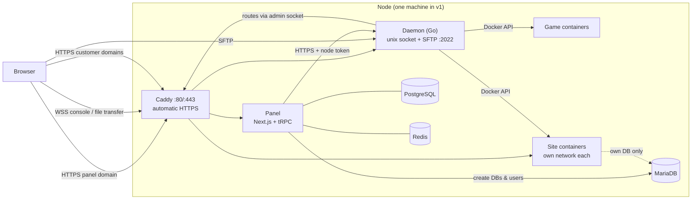

<div align="center">

# BSSG Panel

**One self-hosted control panel for Minecraft servers *and* websites.**

Game servers from templates, PHP/Node/static sites with automatic HTTPS, MariaDB databases,
a live console, a file manager and SFTP — on your own machine, behind Discord login and 2FA.

[Features](#-features) ·
[Architecture](#-architecture) ·
[Quick start](#-quick-start) ·
[Configuration](#%EF%B8%8F-configuration) ·
[Templates](#-templates) ·
[Security](#-security-model) ·
[Development](#-development) ·
[Roadmap](#%EF%B8%8F-roadmap)


</div>

---

## 📖 Table of contents

- [Why this exists](#-why-this-exists)
- [Features](#-features)
- [Architecture](#-architecture)
- [How a request flows](#-how-a-request-flows)
- [Quick start](#-quick-start)
- [Configuration](#%EF%B8%8F-configuration)
- [Templates](#-templates)
- [Websites, domains and SSL](#-websites-domains-and-ssl)
- [Minecraft: Velocity, sleep mode and more](#-minecraft-velocity-sleep-mode-and-more)
- [Users, roles and permissions](#-users-roles-and-permissions)
- [Security model](#-security-model)
- [Repository layout](#-repository-layout)
- [Development](#-development)
- [Testing](#-testing)
- [How this was built](#-how-this-was-built)
- [Roadmap](#%EF%B8%8F-roadmap)
- [FAQ](#-faq)
- [Troubleshooting](#-troubleshooting)
- [Contributing](#-contributing)
- [License](#-license)

---

## 💡 Why this exists

Running a few Minecraft servers *and* a few websites for a group of friends usually means two
panels (one for games, one for web hosting), two login systems, two update cycles and two
sets of quirks. BSSG Panel replaces both with one panel that:

- treats **game servers and websites as the same thing** — a container from a template —
  so console, files, SFTP, limits and permissions work identically for both;
- is built for **trusted users** (friends, a community): no billing, no sign-up flow, but
  real isolation so one compromised WordPress plugin can't touch the rest;
- runs on **a single machine** today, while the panel ↔ node split means a second node is
  just an install away;
- keeps every install-time decision in **one env file**, never in code or the database.

---

## ✨ Features

### For everyone

| | |
|---|---|
| 🎮 **Game servers** | Paper, Folia, Fabric, Velocity, generic Java (8/11/17/21/25) and generic Node.js — from YAML templates |
| 🌐 **Websites** | Static (nginx), PHP 8.2 / 8.3 / 8.4 (nginx + PHP-FPM, WordPress-ready), Node.js, Adminer |
| 🖥️ **Live console** | xterm.js over a WebSocket straight to the node, 500-line backlog, command history, auto-reconnect and token refresh |
| 📜 **Log viewer** | For websites: read-only, filter, pause/follow, colour-coded errors and warnings, download as `.txt` |
| 📊 **Live stats** | CPU, RAM, disk and network every 2 seconds |
| 📁 **File manager** | Browse, edit with Monaco (syntax highlighting), upload via drag & drop, download, rename, zip/unzip |
| 🔐 **SFTP** | Built into the node daemon, authenticated against the panel (password or API key) |
| 🗄️ **Databases** | MariaDB 11 — one database user per database, rights on that database only |
| 🔗 **Domains** | Attach any domain, `www` ↔ apex redirects, live DNS checking with provider-specific instructions |
| 🔒 **Automatic HTTPS** | Let's Encrypt via Caddy, including wildcard certificates through the Cloudflare DNS challenge |
| 💤 **Sleep mode** | Minecraft servers stop when empty and wake up when someone connects |
| 👥 **Subusers** | Invite people by Discord ID with fine-grained permissions per server |
| 🌍 **Two languages** | English by default, Dutch one click away |
| 🎨 **Beautiful defaults** | New sites get a polished "your website is live" page; offline/installing sites get matching status pages instead of a bare 502 |

### For admins

| | |
|---|---|
| 🧭 **Separate admin area** | `/admin`, only reachable for admins with 2FA enabled — enforced on the server, not just hidden in the UI |
| 🏗️ **Server management** | Create servers for any user, change limits (live), owner, ports, variables, template; reinstall or delete |
| 🖧 **Nodes & allocations** | Register nodes with a one-time token and install command; manage IP/port ranges |
| 👤 **Users** | Pre-create accounts by Discord ID, block, reset 2FA, manage admins |
| 🧩 **Templates** | List and edit templates in a YAML editor with validation |
| 🗒️ **Activity log** | Every action, searchable by user, server and action |
| ☁️ **DNS providers** | Connect Cloudflare and set the right records with one click |

---

## 🏛️ Architecture

The panel is the brain and stores everything in PostgreSQL. On each node, a small Go daemon
does the actual work in Docker. Caddy is the only entry point for HTTP(S).



**Key design decisions**

- **The daemon is never exposed directly.** It listens on a unix socket that Caddy proxies on
  its own subdomain (`$NODE_DOMAIN`); only SFTP talks to it directly.
- **The daemon is the source of truth for routes.** It re-applies the full route set on
  startup, after a Caddy restart (detected via health check) and every 5 minutes.
- **Caddy's admin API is a unix socket**, never TCP — so no container can reconfigure it.
- **Every Docker object** the daemon creates is labelled `panel.managed=true` +
  `panel.instance=…`; it never touches anything else on the machine.
- **Contracts first.** The tRPC contract (zod), the daemon OpenAPI spec, the Go `Router`
  interface and the template schema were written before any implementation, so components
  could be built in parallel and tested against each other.

---

## 🔄 How a request flows

<details>
<summary><b>Opening the console</b></summary>

1. The browser calls `servers.consoleToken` on the panel.
2. The panel checks the user's permissions on that server and signs a 10-minute **Ed25519
   JWT** bound to that one server, that one user and their permissions.
3. The browser opens `wss://$NODE_DOMAIN/api/servers/{uuid}/ws` and sends `{"event":"auth","token":"…"}`.
4. The daemon verifies the JWT with the panel's public key (fetched once via JWKS), sends the
   500-line backlog and the current status, then streams `console_output` and `stats`.
5. One minute before expiry it sends `token_expiring`; the browser fetches a new token and
   re-authenticates on the same socket.

</details>

<details>
<summary><b>Creating a website</b></summary>

1. An admin picks a web template (e.g. PHP 8.3) and an owner in `/admin`.
2. The panel turns template + variables into a complete `ServerSpec` and sends it to the daemon.
3. The daemon creates a dedicated bridge network `panel-site-<uuid>`, runs the install script,
   puts a default `index.html` in `public/` and starts the container (non-root, read-only rootfs).
4. While installing, Caddy shows a "this website is being set up" page.
5. The owner adds a domain; the panel shows the exact DNS records and checks them live via
   1.1.1.1 and 8.8.8.8. The daemon pushes the route to Caddy, which obtains the certificate.
6. Creating a database attaches MariaDB to *that site's* network only — sites never see each other.

</details>

<details>
<summary><b>Sleep mode</b></summary>

1. Every minute the daemon pings the server with the Minecraft status protocol to count players.
2. After *N* minutes with nobody online it stops the server cleanly → status `sleeping`.
3. The daemon then listens on the server's port itself: the server list shows a "sleeping"
   MOTD, and a login attempt starts the server and politely asks the player to reconnect in a minute.

</details>

---

## 🚀 Quick start

> [!IMPORTANT]
> The installer is built for a **dedicated Linux machine** (tested on Ubuntu 24.04) with
> Docker. Ports **80, 443 and 2022** must be free.

### 1. Prerequisites

- Linux with systemd, Docker Engine + the Compose plugin
- Go 1.23+ (to build the daemon) — or pass a prebuilt binary with `--daemon-bin`
- Two DNS **A records** pointing to the machine, for example:
  - `panel.example.com` → the panel
  - `node1.example.com` → the node daemon (console, file transfer)
- A **Discord application** (https://discord.com/developers/applications) with redirect URI
  `https://panel.example.com/api/auth/discord/callback`
- Your own Discord user ID (Settings → Advanced → Developer Mode, then right-click your name)

### 2. Install

```bash
git clone https://github.com/St3v3-B/BSSG-Panel.git
cd BSSG-Panel
sudo deploy/install.sh
```

The installer asks for the domains, your Discord ID, the Discord client ID/secret and an
e-mail address for Let's Encrypt. It then:

1. writes `/etc/panel/panel.env` (mode `600`), generating all keys and passwords,
2. builds and installs the daemon (`/usr/local/bin/panel-daemon`) and its systemd unit,
3. builds and starts the stack with Docker Compose (panel, PostgreSQL, Redis, MariaDB, Caddy).

Running it again is safe: existing values are kept, nothing is duplicated.

Non-interactive (e.g. for automation):

```bash
sudo PANEL_DOMAIN=panel.example.com NODE_DOMAIN=node1.example.com \
     ACME_EMAIL=you@example.com OWNER_DISCORD_ID=123456789012345678 \
     DISCORD_CLIENT_ID=… DISCORD_CLIENT_SECRET=… \
     deploy/install.sh --non-interactive
```

Dry run that writes everything into a temporary directory instead of the system:

```bash
deploy/install.sh --dry-run
```

### 3. First login

1. Open `https://panel.example.com` and log in with Discord.
2. Go to **Account** and enable 2FA (any TOTP app).
3. Open **/admin**, add a port allocation to your node, and create your first server or site.

### Updating

```bash
cd BSSG-Panel && git pull && sudo deploy/install.sh --non-interactive
```

---

## ⚙️ Configuration

Everything install-specific lives in **`/etc/panel/panel.env`** — read by Docker Compose
*and* by the daemon's systemd unit. Nothing in the code or database hardcodes a domain.
The full, commented reference is [`deploy/panel.env.example`](deploy/panel.env.example).

| Variable | Required | Description |
|---|:---:|---|
| `PANEL_DOMAIN` | ✅ | Domain of the panel, e.g. `panel.example.com` |
| `NODE_DOMAIN` | ✅ | Domain of this node's daemon, e.g. `node1.example.com` |
| `ACME_EMAIL` | ✅ | E-mail address for Let's Encrypt |
| `OWNER_DISCORD_ID` | ✅ | Discord ID of the owner — always admin, can never be removed |
| `DISCORD_CLIENT_ID` / `DISCORD_CLIENT_SECRET` | ✅ | Discord OAuth2 application |
| `PANEL_ENCRYPTION_KEY` | ✅ | 32 bytes, base64 — AES-256-GCM for secrets at rest (generated) |
| `NODE_TOKEN` | ✅ | Token of the local node (generated) |
| `NODE_PUBLIC_IP` | | IPv4 shown in DNS instructions; auto-detected when empty |
| `DATABASE_URL`, `REDIS_URL`, `POSTGRES_PASSWORD` | | Defaults point at the Compose services |
| `MARIADB_ROOT_PASSWORD` | | Root password of the bundled MariaDB (generated) |
| `MARIADB_CONTAINER`, `MARIADB_ADMIN_ADDR` | | Name of the MariaDB container and how the panel reaches it |
| `SFTP_PORT`, `DAEMON_PORT` | | Default `2022` and `8080` |
| `PANEL_URL`, `DAEMON_URL` | | How the daemon reaches the panel and vice versa |
| `DAEMON_SOCKET`, `DATA_DIR` | | Default `/run/panel/daemon.sock` and `/var/lib/panel` |
| `CADDY_ADMIN_URL`, `CADDY_TLS_ADDR`, `CADDY_CONTAINER` | | Caddy admin socket, HTTPS address for SSL checks, container name |
| `TEMPLATES_DIR` | | Where the panel loads templates from at startup |
| `PANEL_INSTANCE`, `DOCKER_EXTRA_LABELS` | | Label scoping — lets test runs coexist with a real install |
| `PANEL_INSECURE_TEST_LOGIN` | | Tests only; refuses to start unless the domain ends in `.test` |

**Changing the domain later:** edit the env file, then
`systemctl restart panel-daemon && docker compose … up -d`, and update the redirect URI in Discord.

### Where things live

| Path | What |
|---|---|
| `/etc/panel/panel.env` | All configuration and secrets |
| `/var/lib/panel/volumes/<uuid>` | Data of each server (`/home/container` inside the container) |
| `/var/lib/panel/state` | Daemon state: server specs, routes, SFTP host key |
| `/run/panel/` | Daemon socket and Caddy admin socket |
| systemd unit `panel-daemon` | The node daemon |
| Docker objects labelled `panel.managed=true` | Everything the panel created |

---

## 🧩 Templates

A template is a single YAML file. The format is documented in
[`templates/SCHEMA.md`](templates/SCHEMA.md) and validated by a zod schema, so a broken
template fails CI instead of production.

### Game templates

| Template | What | Notes |
|---|---|---|
| **Paper** | High-performance Minecraft server | PaperMC Fill API v3 with SHA-256 check; Velocity forwarding variables; sleep mode |
| **Folia** | Paper's regionised multithreading fork | Same variables as Paper; sleep mode |
| **Fabric** | Modded Minecraft | Fabric meta API; Minecraft and loader version as variables; sleep mode |
| **Velocity** | Modern Minecraft proxy | Modern forwarding, generated secret, `velocity.toml` managed by the panel |
| **Generic Java** | Run any JAR | Java 8, 11, 17, 21 or 25 (Temurin, checksum-verified) |
| **Generic Node.js** | Run any Node app | Node 24, `npm ci` on start, sample `index.js` |

### Web templates

| Template | What | Notes |
|---|---|---|
| **Static website** | nginx | Dotfiles blocked, custom `nginx/*.conf` supported |
| **PHP 8.2 / 8.3 / 8.4** | nginx + PHP-FPM | mysqli, pdo_mysql, gd, intl, zip, exif, curl, mbstring, opcache; 64 MB uploads; WordPress permalinks; `.php` in `uploads/` blocked; CLI works for WP-CLI |
| **Node.js site** | Node app behind Caddy | Dependencies installed at install time |
| **Adminer** | Database UI | Pre-filled with the local MariaDB |

### A minimal template

```yaml
schema: 1
slug: java-generic
name: Generic Java
type: game
version: 1
image: eclipse-temurin:21-jre
startup: java -Xms128M -Xmx{{SERVER_MEMORY}}M -jar {{JAR_FILE}}
stop: { type: command, value: stop }
ready_pattern: "Done \\("
variables:
  - key: JAR_FILE
    name: JAR file
    default: server.jar
    user_editable: true
    pattern: "^[A-Za-z0-9._-]+\\.jar$"
install:
  image: alpine:3.20
  script: |
    #!/bin/sh
    echo "Upload $JAR_FILE via SFTP or the file manager." > /home/container/README.txt
```

Built-in variables: `SERVER_UUID`, `SERVER_MEMORY`, `SERVER_IP`, `SERVER_PORT`, `TZ`.
`config_files` can patch `properties`, `yaml`, `json` and `toml` files before every start
(e.g. `server-port={{SERVER_PORT}}`), keeping comments and formatting.

---

## 🌐 Websites, domains and SSL

The domain screen does the DNS homework for you:

1. **Exact records** — e.g. `A @ → <node IP>` and `CNAME www → example.com`, with copy buttons.
2. **Provider detection** — looks up the nameservers and shows step-by-step instructions for
   Cloudflare, TransIP, Hostinger, Strato, Versio and others.
3. **Live checking** — every 30 seconds while the screen is open, via 1.1.1.1 and 8.8.8.8,
   with a status per record: *missing*, *wrong IP*, *behind Cloudflare proxy*, *ok*.
4. **Common mistakes caught** — Cloudflare's orange cloud, stale AAAA records (there is no
   IPv6), a CNAME on the apex.
5. **SSL status** — `pending`, `issuing`, `active`, `dns_wrong` or `failed` (with the reason).

**Cloudflare integration (optional):** add an API token in `/admin` and the panel sets the
records with one click. It also enables **wildcard certificates** via the DNS-01 challenge
(Caddy is built with the `caddy-dns/cloudflare` module).

**Status pages:** while a site installs, is stopped, is out of disk space or can't be reached,
visitors see a clean, bilingual (EN/NL) status page instead of a raw error.

---

## 🎮 Minecraft: Velocity, sleep mode and more

### Velocity with Paper servers

1. Create a **Velocity** server and copy its forwarding secret.
2. On each **Paper** server set `VELOCITY_FORWARDING=true` and `VELOCITY_SECRET=<secret>` —
   `online-mode` is switched off automatically while forwarding is on.
3. Add the backends to `velocity.toml` via the file manager.

The full walk-through, including the two error messages you may hit, is in
[`deploy/README.md`](deploy/README.md).

### Sleep mode

Enable it per server under **Settings**, choose the idle time (1–1440 minutes), done.
Manually stopping a server means *off* — it won't wake up on its own.

### Heap sizing

Java templates size the heap as the memory limit minus 15% (at least 384 MB headroom), so the
JVM's off-heap memory doesn't get the container killed.

---

## 👥 Users, roles and permissions

- **Login is Discord OAuth2** — an account is tied to a Discord ID. Admins can pre-create
  accounts by Discord ID so a server can be assigned before that person ever logs in.
- **Admins** are whoever is listed in `admin_discord_ids` (the owner is always there).
  There is no `is_admin` flag to forget to check.
- **Admins must enable 2FA** before `/admin` opens; every admin procedure re-checks this on the server.
- **Per-server permissions for subusers:**

| Permission | Allows |
|---|---|
| `console.read` | See the console / logs and live stats |
| `console.write` | Send commands |
| `power` | Start, stop, restart, kill |
| `files.read` | Browse and download files, SFTP read-only |
| `files.write` | Edit, upload, delete, SFTP write |
| `backup.create` / `backup.restore` | Create / restore backups |
| `database.manage` | Create databases, reset passwords |
| `domain.manage` | Add domains, change redirects |
| `schedule.manage` | Manage scheduled tasks |

The owner of a server has all permissions. API keys can be scoped to a subset and can never
reach admin procedures.

---

## 🛡️ Security model

Even with trusted users, a hacked WordPress or Minecraft plugin must not reach anything else.

**Containers**
- Run as a non-root user (uid 1000), with an init process as PID 1
- All Linux capabilities dropped, `no-new-privileges`, PID limit, CPU/RAM/swap limits
- Read-only root filesystem with a tmpfs for `/tmp`
- Every website on its **own bridge network**; MariaDB is attached per site, so sites can't see each other or game servers

**Panel ↔ node**
- Per-node token (stored hashed + encrypted), constant-time comparison
- Browser tokens are short-lived (10 min) Ed25519 JWTs bound to one server, one user and explicit permissions; one-time tokens for uploads/downloads, bound to the exact path
- The daemon enforces permissions itself — it doesn't trust the browser

**Files**
- Every path is resolved with `openat2(RESOLVE_BENEATH)` — no escaping the server directory, not even through symlinks; zip-slip rejected
- Soft disk limits: warning at 90%, writes refused and the server stopped when exceeded; the node also stops the fastest-growing server if the disk drops below 5% free

**Secrets**
- Database passwords, DNS tokens, TOTP secrets and node tokens are encrypted with AES-256-GCM
- Sessions are stored as SHA-256 hashes; cookies are `HttpOnly` and `SameSite=Lax`
- SFTP passwords are hashed with Argon2id; login and SFTP authentication are rate-limited via Redis
- Every action ends up in the activity log

> [!NOTE]
> Found a security issue? Please open a private security advisory on GitHub instead of a public issue.

---

## 🗂️ Repository layout

```
.
├── apps/web/                 Next.js panel (App Router, Tailwind, shadcn/ui)
│   ├── app/                  pages and components (user side + /admin)
│   └── server/               tRPC routers, auth, daemon client, background jobs
├── daemon/                   Go node daemon
│   ├── cmd/panel-daemon/     entry point
│   ├── internal/             docker engine, servers, console, files, SFTP, auth
│   └── proxy/                Caddy integration (Router interface + implementation, status pages)
├── packages/
│   ├── api/                  contracts: tRPC contract (zod), daemon OpenAPI, mock, template schema
│   └── db/                   Drizzle schema and migrations (PostgreSQL 16)
├── templates/
│   ├── SCHEMA.md             template format
│   ├── game/                 Minecraft and generic game templates
│   └── web/                  website templates
├── deploy/                   docker-compose, Caddy build, systemd unit, install script
├── tests/integration/        end-to-end tests against real Docker
└── docs/ontwerp.md           the original design document (Dutch)
```

### Tech stack

| Part | Choice |
|---|---|
| Frontend | Next.js 16 (App Router), TypeScript, Tailwind CSS 4, shadcn/ui, xterm.js, Monaco |
| Backend | Next.js + tRPC 11, Drizzle ORM, zod 4 |
| Auth | Discord OAuth2, own sessions in PostgreSQL, TOTP |
| Database | PostgreSQL 16 (panel), MariaDB 11 (customer databases) |
| Jobs & rate limiting | Redis |
| Node daemon | Go, Docker SDK, gorilla/websocket, pkg/sftp |
| Reverse proxy | Caddy 2 with `caddy-dns/cloudflare`, configured live through its admin API |

---

## 🧑‍💻 Development

```bash
pnpm install
make dev          # panel on :3000 against the in-memory mock (no daemon or DB needed)
make check        # everything CI runs (see below)
```

`make dev` runs the UI against a complete **mock implementation** of the tRPC contract, so
you can work on any screen without Docker. Switch roles with
`MOCK_ROLE=admin|user|pending|anonymous`.

**Useful commands**

```bash
pnpm --filter @panel/api gen         # regenerate TS types after changing openapi.yaml
pnpm --filter @panel/db generate     # new migration after changing schema.ts
pnpm --filter @panel/web build       # production build
cd daemon && go test ./...           # daemon tests (some need Docker)
deploy/test.sh                       # shellcheck, compose validation, template smoke tests
```

**Toolchain:** Node 22, pnpm, Go 1.23+ (module), TypeScript 5.9. Next.js 16 differs from
older versions (`middleware.ts` is now `proxy.ts`) — see `apps/web/AGENTS.md`.

---

## 🧪 Testing

| Level | What | Command |
|---|---|---|
| **Contract** | OpenAPI lint, contract shape, mock output validated against the zod schemas, templates valid, generated types up to date | `make check` |
| **Unit** | ~200 panel tests (against a real PostgreSQL in Docker), daemon unit tests with fakes, UI tests with Testing Library | `make check` |
| **Docker** | Daemon against real Docker, Caddy against a real Caddy (`tls internal`), every web template served through Caddy | `make check` |
| **Templates** | Each game template installed and started as the daemon would, plus Velocity routing a bot between two Paper servers | `deploy/test.sh` |
| **Integration** | Real panel + real daemon + real Docker: login, 2FA, Paper install, console, `say hallo`, daemon restart, subusers, SFTP, disk limit, PHP site + domain + database isolation | `make integration` |

Tests never touch a real installation: every Docker object they create carries
`panel.test=true` plus a unique run label, they use random free ports and temporary
directories, and they clean up only what they created.

---

## 🤖 How this was built

This panel was built by an orchestrating Claude Code session that coordinated several
specialised agents in parallel, each in its own git worktree and branch:

| Agent | Owned |
|---|---|
| `daemon` | the Go daemon (Docker, console, files, SFTP, disk limits, sleep mode) |
| `panel-api` | tRPC routers, auth, 2FA, permissions, daemon client |
| `panel-ui` | all screens, console, file manager, i18n |
| `web-hosting` | Caddy integration, web templates, status pages |
| `templates-ops` | game templates, Docker Compose, systemd, installer |
| `admin` | the extended admin area |

The orchestrator wrote the contracts first (phase 0), answered contract questions, reviewed
and merged green branches and ran the integration tests after every merge. The rules each
agent followed are in [`CLAUDE.md`](CLAUDE.md); the original plan is in
[`docs/ontwerp.md`](docs/ontwerp.md).

---

## 🗺️ Roadmap

| Phase | Scope | Status |
|---|---|---|
| **0** | Contracts and skeleton | ✅ Done |
| **1** | One Minecraft server end-to-end: Discord login, 2FA, console, stats, restart-safe daemon | ✅ Done |
| **2** | Files, SFTP, subusers, disk/CPU/RAM limits, more game templates, Velocity | ✅ Done |
| **3** | Websites, domains, automatic SSL, DNS help, Cloudflare, MariaDB | ✅ Done |
| — | Sleep mode for Minecraft, extended admin area (suspend, change template, bulk actions, settings) | 🚧 In progress |
| **4** | Backups to S3 (with database dumps, checksums and safe restore), schedules, emergency account, `uninstall.sh`, docs | 📋 Planned |

**Later / ideas:** moving servers between nodes, IPv6, a node-only install mode, bundling
Monaco instead of loading it from a CDN.

**Out of scope for v1:** e-mail hosting, billing and sign-up, running your own nameservers.

---

## ❓ FAQ

<details>
<summary><b>Can I use it without Discord?</b></summary>

Not in v1 — Discord is the login. An emergency account with password + mandatory TOTP is
planned for phase 4, for when Discord itself is down.
</details>

<details>
<summary><b>Does it support multiple machines?</b></summary>

The architecture does (panel ↔ daemon over HTTPS with per-node tokens, and nodes can be
registered in `/admin`), but v1 is developed and tested on a single machine.
</details>

<details>
<summary><b>Can it run next to Pterodactyl/Pelican or aaPanel?</b></summary>

Only if they don't use ports 80, 443 and 2022. The panel only ever touches Docker objects
carrying its own labels, so it won't interfere with other containers.
</details>

<details>
<summary><b>Is there IPv6?</b></summary>

No, not in v1. The DNS check warns about leftover AAAA records for exactly that reason.
</details>

<details>
<summary><b>Where are backups?</b></summary>

Phase 4. Until then, use SFTP or your own snapshot of `/var/lib/panel`.
</details>

---

## 🩺 Troubleshooting

| Symptom | Likely cause / fix |
|---|---|
| Certificate stays `issuing` or shows `dns_wrong` | The A record doesn't point at the node, or Cloudflare's proxy (orange cloud) is on — set it to DNS only |
| Discord login says "invalid redirect" | The redirect URI in the Discord developer portal must be exactly `https://<PANEL_DOMAIN>/api/auth/discord/callback` |
| `/admin` keeps redirecting to Account | Admins must enable 2FA first |
| Site shows "this website is being set up" | The install is still running — PHP templates compile extensions on first install (1–2 min) |
| Upload refused: disk full | The server hit its disk limit; delete files or ask an admin to raise the limit |
| Console doesn't connect | Check that `NODE_DOMAIN` resolves to the node and `systemctl status panel-daemon` is running |
| Minecraft server killed right after start | Memory limit too low for the heap; give the server more RAM |

Logs:

```bash
journalctl -u panel-daemon -f          # daemon
docker logs -f panel-web               # panel
docker logs -f panel-caddy             # Caddy / certificates
```

---

## 🤝 Contributing

Issues and pull requests are welcome. Please:

1. run `make check` before opening a PR (and `deploy/test.sh` if you touch `deploy/` or templates),
2. keep commits small, with the component first (`daemon: …`, `panel-ui: …`),
3. never hardcode a domain — tests use `panel.test` and `node1.test`,
4. change the contracts in `packages/api/` deliberately and in their own commit.

---

## 📄 License

No license has been chosen yet, which means all rights are reserved by default. If you'd like
to use this code, open an issue and ask.

---

<div align="center">

Made for friends who play Minecraft and run websites. ⛏️🌐

</div>
